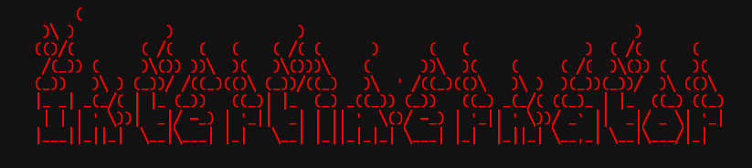

A small tui-interval-timer to remind you of anything

---

### Description
Intertimernator is a simple interval-timer. After pressing "Start Timer", a new terminal-window will open every 15 Minutes, displaying a custom message.
Use it for work, for your projects, or whatever. It's a great tool if you're easily distracted!

### How does this work
The program is very simple: "Start Timer" to start the intervals, "Stop Timer" to stop them, "Configure" to configure your message; [I have also written a tutorial!](docs/tutorial.md)

### :construction: Planned features :construction:
- [ ] Configurable intervals
- [x] In-App customization of the reminder-message
- [ ] Button clicking sound-effects

---

### How to install
Simply grab a setup from the releases-section and run it. You can choose a directory to install wherever you like, it'll run.

### How to uninstall
Simply run the "Uninstall Intertimernator" within the uninstall-directory.