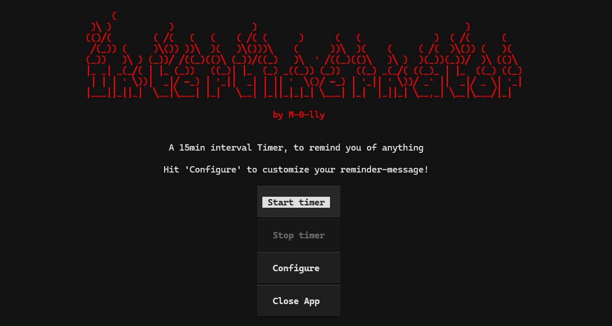
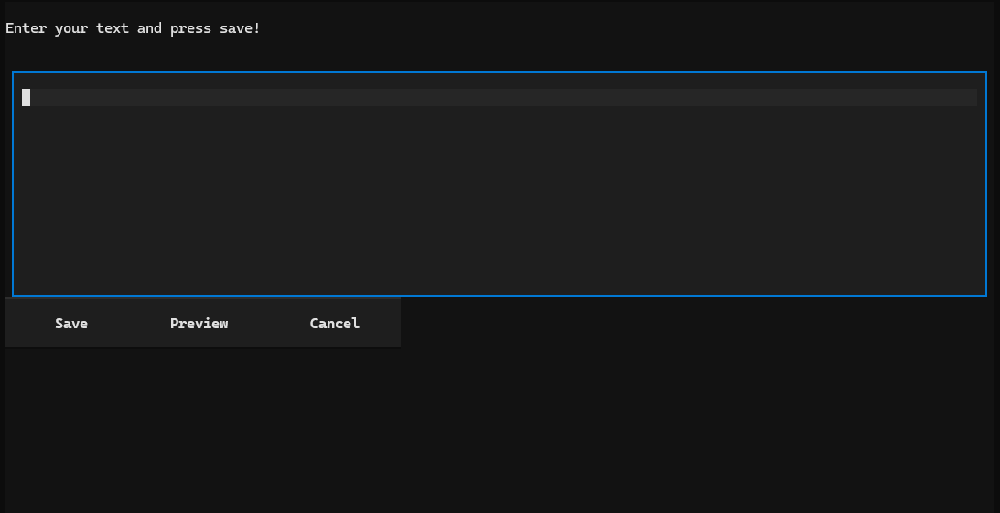
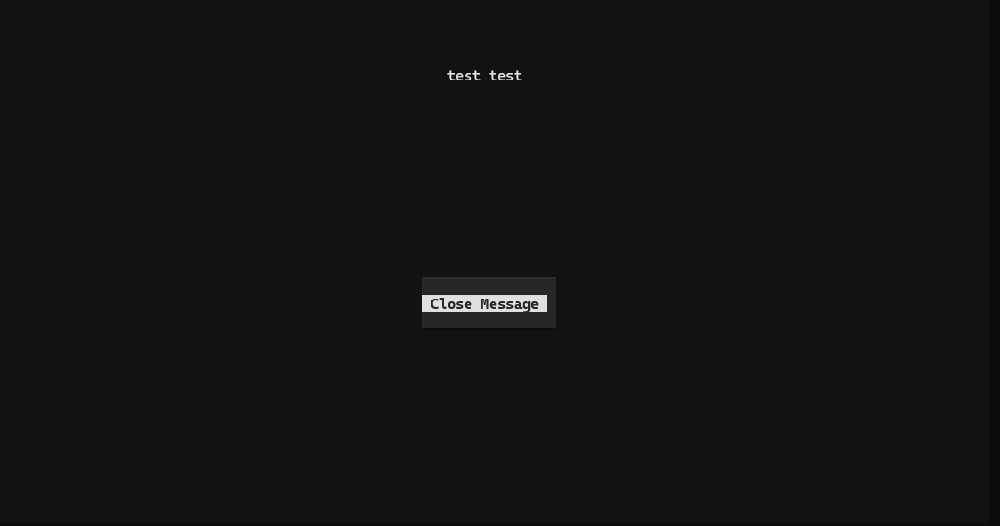

# Intertimernator Tutorial (for v1.1.1)

This is a tutorial for the "Intertimernator"-Interval-Timer.

---

### General

As of now, the program can do the following:

- Start the intervals
- Pause the intervals
- Configure the message
- Close the app

---

### Main-Menu

In the Main-Menu, you can start and pause the intervals.

- Press "Start timer" to start the intervals. Every 15 Minutes, your [Message](#Message) will open as a separate window.
- Press "Stop timer" to pause it. 
- Press "Configure" to configure your message. A second window will open, the [Message-Editor](#Message-Editor)
- Press "Close App" to close the app.

---

### Message-Editor

In the Message-Editor, you can customize your message to your liking!

Are you easily distracted? Do you forget to drink water a lot? Doesn't matter, type it in, Intertimernator will remind you (every 15 Minutes).

- Press "Save" to save your text. It will be displayed with the next interval. (Note: Make sure to start the timer again after finishing your editing)
- Press "Preview" to get a preview of your message.
- Press "Cancel" to close the editor (Note: Don't forget to save.)

---

### Message

This is the message you configure. Press "Close Message" to close it.